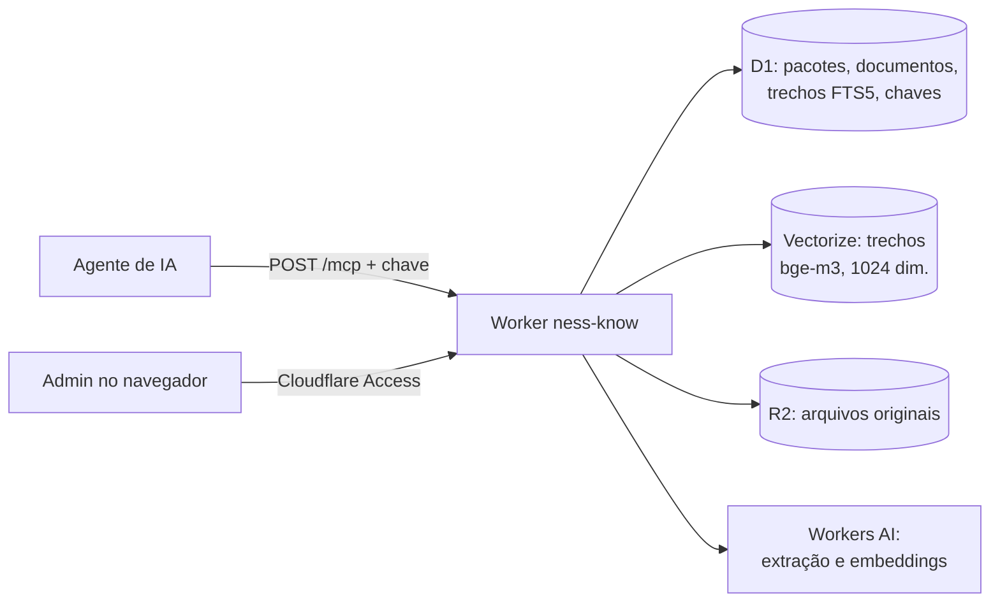

# ness.know

Base de normas, leis e frameworks curada pela ness., consultada por agentes de IA via MCP.

Um agente (Claude Code, Codex, Cursor, o faBRAINzio, o ness.brain) recebe uma **chave de API**. A chave define quais pacotes e quais normas ele enxerga. O agente pergunta em linguagem natural e recebe trechos citáveis, com documento, versão, seção e uma referência rastreável.



## O que está na base

A base é organizada em **pacotes**. Cada pacote reúne documentos de um domínio e traz instruções de uso para o agente.

| Pacote (slug) | Conteúdo |
| --- | --- |
| `seguranca-conformidade` | ABNT NBR ISO/IEC 27001, 27017, 27018, 20000-1, 27701, 31000 e 42001; SCF (CDPAS, SCR-CAP, Quantum); NIST CSF 2.0 e SP 800-61r3; CIS Controls v8.1 |
| `scf-strm` | SCF 2026.3: mapeamentos STRM de 268 frameworks (ISO 27001/27002/27017/27018/27701/42001/31000/22301, NIST CSF 2.0 e 800-53, CIS v8.1, IEC 62443, NIST 800-82, NERC CIP, C2M2, PCI DSS, SOC 2, DORA, NIS2, LGPD, C5, ISM…) e o catálogo dos 1.591 controles (objetivos de avaliação, evidências, maturidade). Sem BCB, REN 964, ISO 20000-1 nem ITIL |
| `setor-eletrico` | ANEEL REN 964/2021 |
| `gestao-servicos-ti` | ITIL 4 Foundation |
| `dispositivos-medicos` | IEC 62304 (software de dispositivo médico) |
| `forense-digital` | ISO/IEC 27037 (evidência digital); carga pendente |

A relação exata de documentos e versões fica na aba **Pacotes** da interface, e o agente a consulta com a ferramenta `listar_pacotes`. Recarregar um pacote atualiza essa relação.

## Controle de acesso

- **Por pacote ou por norma.** Ao gerar a chave, você marca os pacotes inteiros ou abre um pacote e escolhe as normas uma a uma.
  - Pacote inteiro inclui as normas carregadas depois.
  - Pacote parcial fica restrito aos títulos escolhidos.
- **Só restringe.** O filtro que o agente envia na busca só restringe o que a chave já libera.
- **Chave guardada em hash.** O servidor guarda só o hash SHA-256 da chave e a mostra uma única vez, na criação. Para mudar o que uma chave enxerga, revogue-a e gere outra.
- **Administração.** A interface e a API de administração ficam atrás do Cloudflare Access, e o Worker confere o token e a lista `ADMIN_EMAILS`.

## Para quem vai usar (agentes)

| | |
| --- | --- |
| Endereço | `https://know.ness.com.br/mcp` (MCP Streamable HTTP, sem sessão) |
| Autenticação | `Authorization: Bearer nesskb_…` |
| Ferramentas | `listar_pacotes`, `buscar_conhecimento(consulta, pacotes?, limite?)`, `correlacionar(item, de, para)`, `cobertura(de, implementados, alvo)`, `detalhar_controle(scf)`, só leitura |

Para conectar Claude Code, Codex, Cursor, VS Code ou Claude Desktop, use as receitas em [docs/conectar.md](docs/conectar.md) ou a aba **Conectar um agente** da interface; logo depois de gerar uma chave, a aba já mostra as receitas com ela. A referência completa das ferramentas está em [docs/mcp.md](docs/mcp.md).

## Para quem administra

Abra `https://know.ness.com.br` com um e-mail autorizado.

| Aba | Para quê |
| --- | --- |
| Chaves | Gerar uma chave por agente (pacotes inteiros ou normas escolhidas), ver o último uso, revogar |
| Pacotes | Ver documentos, versões e situação de cada um; comando de carga |
| Conectar um agente | Receitas por cliente e um `curl` para conferir a chave |
| Testar a busca | Fazer a pergunta como o agente faria e ver os trechos, na ordem em que ele os receberia |

Carga de pacotes, implantação e operação: [docs/operacao.md](docs/operacao.md).

## Como a busca funciona

A busca é **híbrida**:

- **Por palavra:** SQLite FTS5. Códigos como `A.8.16` e `Art. 6` viram busca por frase exata.
- **Por significado:** Vectorize com o modelo multilíngue `bge-m3`, então pergunta em português encontra texto em inglês.
- **Fusão:** as duas listas se combinam por posição recíproca (RRF), com peso 0,5 para a busca por palavra. O melhor resultado por palavra sempre fica com a última vaga.
- **Medição:** com 36 perguntas-gabarito, a resposta certa aparece entre os 5 primeiros em 92% dos casos na busca por significado e em 89% na híbrida. A híbrida é a padrão porque não perde os códigos exatos.

Detalhes e decisões: [docs/arquitetura.md](docs/arquitetura.md).

## Documentação

| Documento | Conteúdo |
| --- | --- |
| [docs/conectar.md](docs/conectar.md) | Receitas de conexão por cliente |
| [docs/mcp.md](docs/mcp.md) | Referência do servidor MCP: ferramentas, formatos, erros |
| [docs/api-admin.md](docs/api-admin.md) | API de administração |
| [docs/arquitetura.md](docs/arquitetura.md) | Componentes, modelo de dados, pipeline de ingestão e de busca |
| [docs/operacao.md](docs/operacao.md) | Implantação, carga de pacotes, rotina e solução de problemas |
| [docs/seguranca.md](docs/seguranca.md) | Modelo de acesso, ameaças consideradas e limites |
| [docs/spec.md](docs/spec.md) | Decisão de criar o serviço (30/10/2026) |
| [docs/skills-plano.md](docs/skills-plano.md) | Plano de skills sobre a base (proposta) |
| [docs/lacunas.md](docs/lacunas.md) | Lacunas conhecidas, pendências de produção e ordem recomendada |

## Estrutura do repositório

```
src/
  worker.ts     roteamento: /health, /mcp (chave), /api/* (Access), interface
  mcp.ts        servidor MCP, chaves de API, restrição por pacote e por norma
  admin.ts      API de administração
  acesso.ts     validação do token do Cloudflare Access
  busca.ts      corte em trechos, seções, ingestão, vetores e busca híbrida
  fts.ts        montagem da consulta FTS5
public/         interface de administração (HTML e JS, sem build)
scripts/        carregar-pacote, vetorizar, avaliar-busca, conversores do SCF (strm-*, scf-catalogo-*)
migrations/     esquema do D1
test/           testes (Vitest)
```

## Desenvolvimento

```bash
npm install
npm test          # testes
npm run check     # tipos
npm run dev       # wrangler dev
```

A implantação usa o Wrangler; veja [docs/operacao.md](docs/operacao.md).
